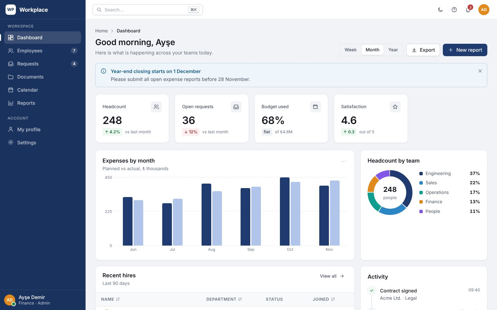
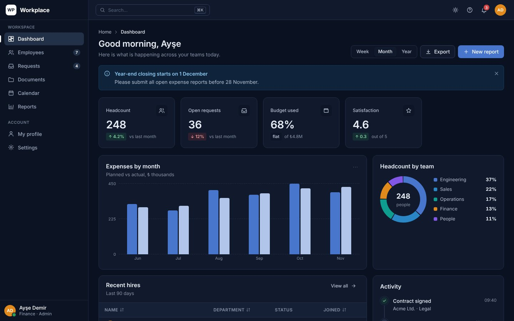
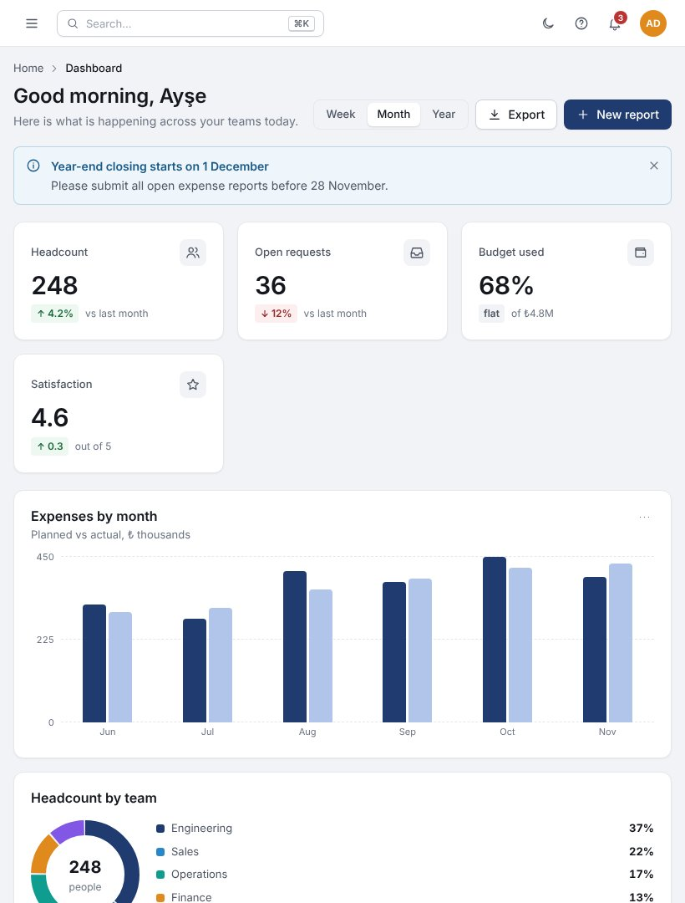
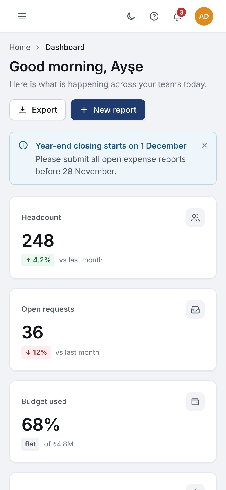
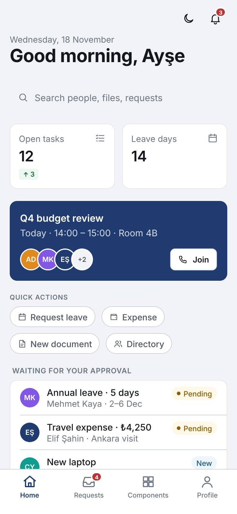

# My Design

Components for office web and mobile apps: a React package for the web, a React Native package for mobile, and one set of tokens and icons behind both. Navy and white, with day and night themes.

Demo: [muhsinaotahonova.github.io/my-design-template](https://muhsinaotahonova.github.io/my-design-template/)

```
pnpm install
pnpm demo        # builds the demo site into ./site
pnpm web         # web starter app
pnpm mobile      # Expo mobile starter
pnpm storybook
```

To change the brand color, edit `BRAND` in `packages/tokens/src/index.ts`. Web and mobile both follow.

Motion uses the shared `motion` tokens (durations, easing curves, spring presets) and turns off when the system asks for reduced motion.

## Word a Day (IELTS vocabulary app)

A small app built only with these components: [muhsinaotahonova.github.io/my-design-template/ielts/](https://muhsinaotahonova.github.io/my-design-template/ielts/)

- Add 10 words a day (your own, or from a built-in IELTS word list), each with a meaning, an example, and an optional picture or video link.
- End-of-day review: round 1 on today's words, round 2 on all words so far (weakest first).
- Games: flashcards, multiple choice, picture quiz, matching, spelling, mixed quiz.
- Friday is check day: one pass over the week's words (70 at 10 a day) with a score.
- Streak, 12-week activity grid and badges. Everything is saved in the browser; download a backup from Progress.

```
pnpm --filter ielts-words dev
```

## Components

<a href="https://muhsinaotahonova.github.io/my-design-template/#components"></a>

## Web app

<table>
  <tr>
    <td width="50%"><a href="https://muhsinaotahonova.github.io/my-design-template/#web"></a><br><b>Day</b></td>
    <td width="50%"><a href="https://muhsinaotahonova.github.io/my-design-template/#web"></a><br><b>Night</b></td>
  </tr>
</table>

## Tablet and mobile

<table>
  <tr>
    <td align="center" width="40%">
      <a href="https://muhsinaotahonova.github.io/my-design-template/#web"></a><br>
      <b>Tablet</b>
    </td>
    <td align="center" width="20%">
      <a href="https://muhsinaotahonova.github.io/my-design-template/web/"></a><br>
      <b>Website on phone</b>
    </td>
    <td align="center" width="20%">
      <a href="https://muhsinaotahonova.github.io/my-design-template/mobile/"></a><br>
      <b>Mobile app · day</b>
    </td>
    <td align="center" width="20%">
      <a href="https://muhsinaotahonova.github.io/my-design-template/mobile/?theme=dark"></a><br>
      <b>Mobile app · night</b>
    </td>
  </tr>
</table>

[All components](https://muhsinaotahonova.github.io/my-design-template/#components) ·
[Web app](https://muhsinaotahonova.github.io/my-design-template/#web) ·
[Mobile app](https://muhsinaotahonova.github.io/my-design-template/#mobile) ·
[Side by side](https://muhsinaotahonova.github.io/my-design-template/#side-by-side) ·
[Storybook](https://muhsinaotahonova.github.io/my-design-template/storybook/)
