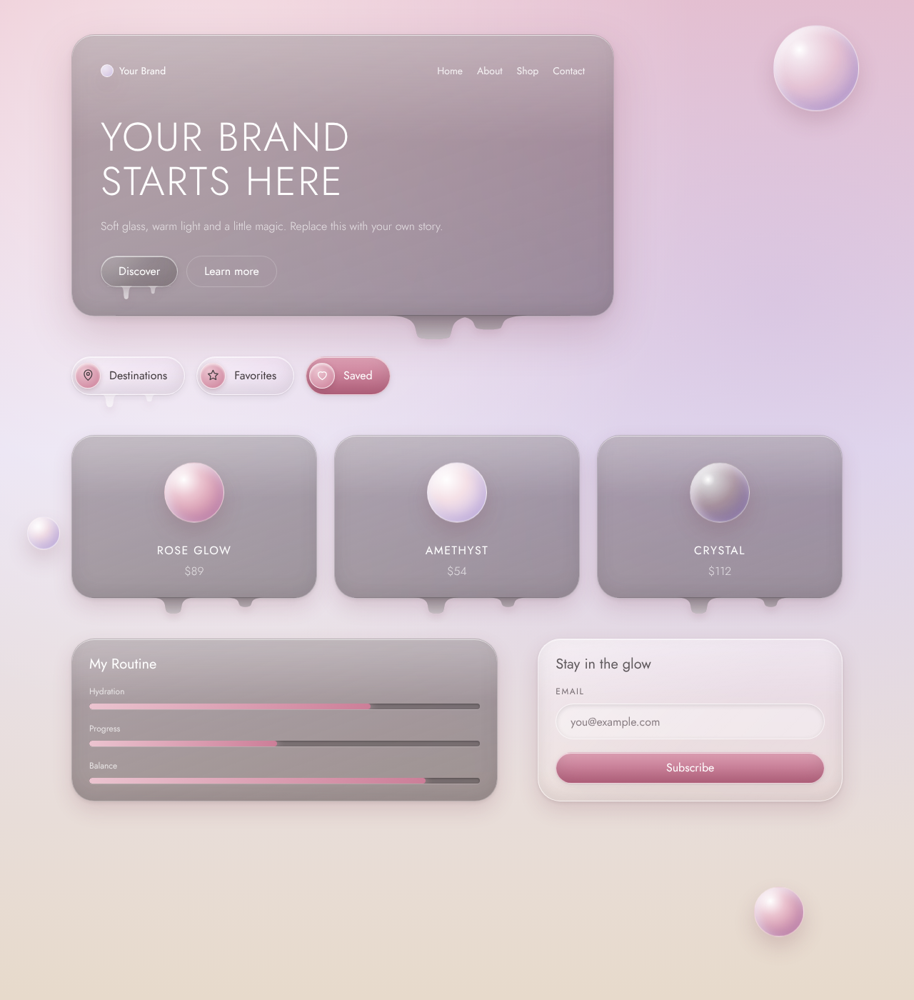

# My Design — tasarım sistemi şablonu

Kendi stilimle web siteleri ve mobil uygulamalar başlatmak için monorepo şablonu.
Buzlu cam paneller, toz pembe / lavanta / kum renkleri, yumuşak 3D derinlik,
"eriyen" kenarlar, hap şeklinde butonlar ve ince büyük harfli başlıklar.



## 🌸 Canlı demo

**👉 [muhsinaotahonova.github.io/my-design-template](https://muhsinaotahonova.github.io/my-design-template/)**

Herkes tıklayıp açabilir, kurulum gerekmez. Sayfada:

| Sekme | Ne görürsün |
| --- | --- |
| [Web](https://muhsinaotahonova.github.io/my-design-template/#web) | Örnek web sitesi bir tarayıcı penceresinde; Masaüstü / Tablet / Telefon genişliği arasında geçiş |
| [Mobil](https://muhsinaotahonova.github.io/my-design-template/#mobil) | Expo mobil uygulaması bir telefon çerçevesinde ("Ana sayfa" ve "Bileşenler" ekranları) |
| [Yan yana](https://muhsinaotahonova.github.io/my-design-template/#yan-yana) | Web ve mobil aynı anda |
| [Tüm bileşenler](https://muhsinaotahonova.github.io/my-design-template/#bilesenler) | Her bileşenin her türü: renkler, yazı, butonlar, cam paneller, damlalar, küreler, form, ilerleme, köşe ve boşluk |

Doğrudan linkler:
[web sitesi](https://muhsinaotahonova.github.io/my-design-template/web/) ·
[mobil uygulama](https://muhsinaotahonova.github.io/my-design-template/mobile/) (telefonda açınca tam ekran uygulama gibi görünür) ·
[Storybook](https://muhsinaotahonova.github.io/my-design-template/storybook/)

Demo, `main` dalına her push'ta `.github/workflows/pages.yml` ile otomatik güncellenir.
Yerelde aynı siteyi üretmek için: `pnpm demo` (çıktı `site/` klasörüne).

## İçinde ne var

| Klasör | Ne işe yarar |
| --- | --- |
| `packages/tokens` | Stilin kalbi: renkler, fontlar, boşluklar, köşeler, gölgeler. Buradaki değeri değiştirirsen her şey güncellenir. |
| `packages/ui-web` | React bileşenleri: `Button`, `GlassPanel`, `Heading`, `Text`, `Input`, `Progress`, `Orb`, `Drip`, `Scene` |
| `packages/ui-native` | Aynı bileşenler React Native (Expo) için |
| `apps/docs` | Storybook: tüm bileşenleri ve token'ları görüp denediğin vitrin |
| `apps/web-starter` | Vite + React örnek site, yeni web projesi için başlangıç |
| `apps/mobile-starter` | Expo örnek uygulama, yeni mobil proje için başlangıç |
| `apps/showcase` | Canlı demo sayfası (web + mobil önizleme, tüm bileşenler) |

Araçlar: **pnpm workspaces** + **Turborepo**.

## Başlarken

Gerekenler: Node.js 22+ ve pnpm (`corepack enable` yazman yeterli).

```bash
pnpm install
pnpm build          # tüm paketleri derler

pnpm storybook      # bileşen vitrini → http://localhost:6006
pnpm web            # örnek site → http://localhost:5173
pnpm mobile         # Expo; telefondaki Expo Go ile QR kodu okut
pnpm demo           # canlı demo sitesini site/ klasörüne derler
```

## Yeni proje açmak

1. GitHub'da bu repoyu **Settings → Template repository** olarak işaretle.
2. Yeni projede **Use this template** de.
3. İhtiyacın olmayan uygulamayı (`apps/web-starter` veya `apps/mobile-starter`) sil,
   kalanın adını değiştir ve geliştirmeye başla.

## Stili değiştirmek

Her şey `packages/tokens/src/index.ts` dosyasında:

- `palette`: ana renk tonları (rose, lavender, sand, smoke)
- `colors`: anlamlı renkler (primary, text, surface…)
- `gradients`, `shadows`: cam ve 3D his
- `typography`: font (şu an **Jost**), boyutlar, harf aralığı
- `radii`, `spacing`: köşe ve boşluk ölçüleri

Webde token'lar `--md-*` CSS değişkenleri olarak da gelir
(örn. `var(--md-rose-300)`), uygulamada `@my-design/ui-web/styles.css` dosyasını bir kez import etmen yeterli.

## Kullanım örneği

```tsx
import { Button, GlassPanel, Heading, Text } from "@my-design/ui-web";
import "@my-design/ui-web/styles.css";

<GlassPanel tone="dark" tilt drip>
  <Heading level={1}>Merhaba</Heading>
  <Text muted>Cam gibi, hafif eriyen bir kart.</Text>
  <Button drip>Keşfet</Button>
</GlassPanel>
```

Mobilde aynı isimlerle `@my-design/ui-native` kullanılır.
